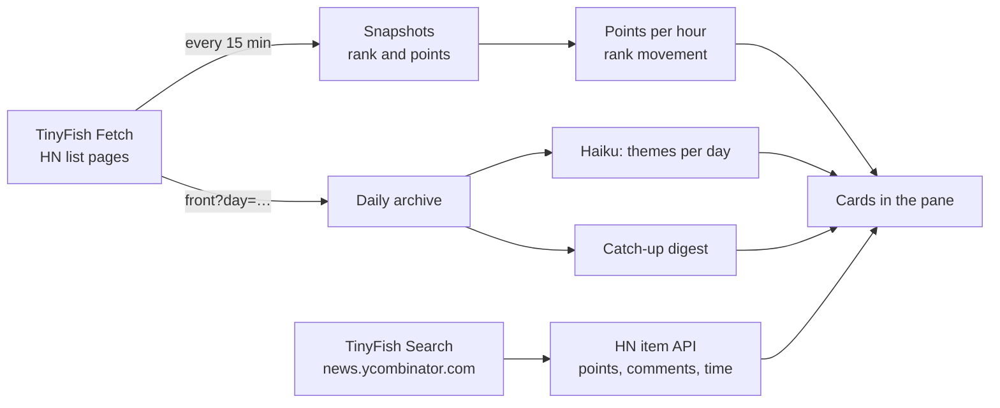

# HN pulse

A Claude Code mod that keeps a live Hacker News trend widget beside your session.
You program the widget in plain language, and your main chat stays free.

```text
HN pulse · TinyFish API · refreshed 2m ago                   r: Refresh
+ Track something: Rust launches with 100+ points today         ⏎ add

Trending now · 3m ago                                        edit ↓ x
front page · 24h · by velocity · list · top 8 · every 15m
▸   1 Cloudflare acquires Deno                1190   606c  +66/h  ↑2
▸   2 Triple-A Minesweeper                     904   173c  +57/h
▸   3 REA Reverse – Engineer Anything          344   119c  +49/h  new

Rising themes · 2h ago                                     edit ↑ x
front page · 7d · by points · themes · top 6 · every 360m
↑ Programming languages and tools  ▃▁▃█▆▆▆  18 stories
↑ Retro software in browser        ▁▁█▅██▅   8 stories
→ AI model releases                █▁▅▅█▅▅  15 stories
```

- **Trending now:** every 15 minutes the mod reads the HN lists and measures points per hour and rank movement.
- **Programmable cards:** type what you want to track. Claude (Haiku) turns your words into a card, you check the preview, and you add it.
- **Rising themes:** Haiku groups the titles of the daily front pages into themes and shows how each theme moves.
- **Catch-up:** after more than 12 hours away, a card lists the top stories of the days that you missed, with a short digest.
- **Thread summaries:** press `▸` beside a story to read a three-line summary of its thread, in the pane.

The data comes from [TinyFish](https://tinyfish.ai) Search and Fetch, and from the official [HN API](https://github.com/HackerNews/API).

## Requirements

- **Claude Code 2.1.293 or later**, in a terminal or in a local session of the desktop app. Mods are on by default. Your organization can turn them off.
- **A TinyFish account.** The free tier covers normal use. You can use an API key or the `tinyfish` CLI login.
- **Claude usage.** Card specs, digests, themes and thread summaries are short Haiku calls on your Claude Code plan or API key.

## Install

Run this command in your shell. It adds the marketplace and installs the mod for your user account:

```bash
claude plugin install hn-mod --marketplace aravindputrevu/claude-code-mods
```

Then start a new Claude Code session, in the terminal or in the desktop app. The pane opens by itself.

To install from inside a Claude Code terminal session, run this command instead:

```text
/plugin install hn-mod --marketplace aravindputrevu/claude-code-mods
```

Answer `y` to add the marketplace, then select **Install for you (user scope)**.

> [!NOTE]
> A mod runs with your Claude Code permissions. Read the source before you install it. This mod sends HTTP requests only to `api.search.tinyfish.ai`, `api.fetch.tinyfish.ai` and `hacker-news.firebaseio.com`. It runs one local command, the `tinyfish` CLI, and only when no API key is set.

## Connect TinyFish

The mod uses the first of these that it finds.

1. **The API key option (recommended).** Get a key at [agent.tinyfish.ai/api-keys](https://agent.tinyfish.ai/api-keys). In a Claude Code session, run `/plugin configure hn-mod@hn-mod` and paste the key into **TinyFish API key**. Claude Code keeps it in your system's secure storage.
2. **The `TINYFISH_API_KEY` environment variable**, in the environment that starts Claude Code.
3. **The `tinyfish` CLI login.** Install it with `npm install -g @tiny-fish/cli`, then run `tinyfish auth login`. With the CLI, search cards cannot ask TinyFish for a time window, so the mod filters the results by story time.

> [!WARNING]
> Do not pass the key with `--config` on the command line. Your shell history keeps it.

The pane header shows which route is in use: `TinyFish API` or `TinyFish CLI`.

## Use the pane

The pane opens when a session starts. A terminal must be at least 144 columns wide for a pane that opens by itself. In a narrower terminal, a one-line band above the prompt shows the top story. Press **Open** on the band, or run `/hn`.

| To | Do this |
| --- | --- |
| Give the pane the keyboard | Click it, or press `Ctrl+X` then `Tab`. `Esc` gives the keyboard back to the prompt |
| Add a card | Type what to track in the `+` box and press `Enter`. Check the preview, then press **Add card** |
| Change the preview | Type a change, such as "only the last 6 hours", and press `Enter` again |
| Change a card | Press **edit** on the card, type the change, then press **Save card** |
| Move or remove a card | Press **↑**, **↓** or **x** on the card |
| Read a thread | Press **▸** beside a story. The title opens the story, and the comment count opens the HN thread |
| Refresh every card | Press `r` (**Refresh**), or run `/hn refresh` |

Two cards come with the mod: **Trending now** and **Rising themes**. The catch-up card appears only after more than 12 hours away, and **x** removes it.

### Program the pane

Each card is one small spec. Haiku writes the spec from your words, and the pane checks every field before it shows the preview. Typical results:

| You type | The card |
| --- | --- |
| Rust launches with 100+ points today | Show HN · "rust" · ≥100 pts · 24h · by points · list |
| what is hot on the front page right now | front page · 6h · by velocity · list |
| MCP and agent tooling chatter this week, summarized | search · "MCP agent tooling" · 7d · by points · digest |
| biggest debates on Ask HN this week | Ask HN · ≥50 comments · 7d · by comments · list |
| themes of the front page this month | front page · 30d · by points · themes |
| show how Postgres stories trend | search · "Postgres" · 7d · by new · spark |

The spec has these fields:

| Field | Values |
| --- | --- |
| `source` | `front` (front page), `new`, `show` (Show HN), `ask` (Ask HN), `search` (TinyFish Search limited to HN) |
| `query` | The search terms for `search`. A title filter for the lists, with alternatives split by `\|` |
| `window` | `1h`, `6h`, `24h`, `7d`, `30d`. A `front` card with `7d` or `30d` reads the daily archive pages |
| `minPoints`, `minComments` | Whole numbers |
| `sort` | `velocity` (points per hour), `points`, `comments`, `new` |
| `view` | `list`; `spark` (a points sparkline per story, or stories over time for a search); `themes`; `digest` (two sentences above the list) |
| `limit` | 1 to 15 stories |
| `everyMinutes` | How often the card refreshes, 5 to 1440 |

## How it measures trends



- **Points per hour** compares the newest snapshot with the snapshot nearest to one hour old. Until there are two snapshots, it is the average since the story was posted.
- **Archive days** are cached. A day read 12 hours after it ended is final. A more recent day is read again after 3 hours.
- **Digests and themes** call the model again only when their stories change.

## Settings

Change the settings with `/plugin configure hn-mod@hn-mod`. The settings that are not secret are also rows in `/config`.

| Setting | Default | What it does |
| --- | --- | --- |
| `tinyfish_api_key` | empty | Your TinyFish API key. Kept in secure storage |
| `tinyfish_cli` | `tinyfish` | The CLI command when no key is set. Use an absolute path if Claude Code does not find the CLI on its `PATH` |
| `model` | `haiku` | The model for card specs, digests, themes and thread summaries. Calls use low effort |
| `snapshot_minutes` | `15` | How often the mod reads the HN lists (5 to 120) |
| `auto_open` | `true` | Open the pane when a session starts |

## Costs and limits

- **TinyFish Fetch** is free for up to 1,000 URLs a day. The mod reads each HN list that your cards use once per snapshot: about 96 URLs a day per list at the default interval. Archive days and thread pages add a few more.
- **TinyFish Search** is free for up to 12,000 requests a day. Each search card sends one or two requests per refresh.
- **Claude** calls run on your plan or API key. A card spec, a digest or a thread summary is one short Haiku call. Themes run again only when the archive changes.

## Data and privacy

- **TinyFish** gets the HN page addresses and the search terms of your cards.
- **The HN API** gets the ids of stories that search cards show.
- **Claude** gets story titles, thread text for the summaries that you open, and the words that you type in the `+` box.
- **Your machine** keeps the cards, snapshots, archive and caches in `~/.claude/plugins/store/hn-mod_*.json`. Every Claude Code session on the machine shares this store.

## Troubleshooting

| You see | Do this |
| --- | --- |
| No pane | Widen the terminal to 144 columns, press **Open** on the band, or run `/hn` |
| `"tinyfish" is not on PATH` | Set a TinyFish API key, or set `tinyfish_cli` to the absolute path of the CLI |
| `TinyFish Search refused the API key (401)` | Check the key at agent.tinyfish.ai/api-keys and set it again |
| `… is over its limit (429)` | The free tier is used up for today. The card tries again later |
| `The model call for "haiku" failed: …` | The text gives the reason. A failed card tries again after 5 minutes |
| Nothing from the mod at all | Run `/plugin` and open the **Errors** tab. Your organization can turn mods off |

The last error of each card is also kept under `errors` in the store file. To see every hook problem, start Claude Code with `claude --debug`.

## Update and uninstall

Third-party marketplaces do not update by themselves. To update the mod, run:

```bash
claude plugin update hn-mod@hn-mod
```

To turn on updates for this marketplace, open `/plugin`, go to **Marketplaces**, select `hn-mod`, and select **Enable auto-update**.

To uninstall the mod and remove the marketplace, run:

```bash
claude plugin uninstall hn-mod@hn-mod
claude plugin marketplace remove hn-mod
```

## Develop

Clone the repo and load your copy for one session. Saved files reload by themselves:

```bash
git clone https://github.com/aravindputrevu/claude-code-mods.git
cd claude-code-mods
claude --plugin-dir .
```

Check and test the mod:

```bash
claude plugin validate .
claude plugin test .
```

| File | What it holds |
| --- | --- |
| `hooks/register.tsx` | The hooks module: every call on `$`, the state atoms, the refresh timer, the pane and band hooks |
| `hooks/pane.tsx` | The pane and the band, sized to the width the pane gets |
| `hooks/sources.ts` | TinyFish request shapes, the HN list parser (both layouts that TinyFish Fetch returns), and the HN item API rows |
| `hooks/trend.ts` | Snapshots, points per hour, filters, sort, sparklines |
| `hooks/spec.ts` | The card spec, its checks, and the default cards |
| `hooks/compile.ts`, `hooks/digest.ts` | The model prompts and the reply readers |
| `types/index.d.ts` | The `$.state` contract |
| `tests/` | Tests, with a real TinyFish front-page reply (user names replaced) |

Two rules from the mod API:

- **Keep `$` in `register.tsx`.** `claude plugin validate` follows `$` only into functions of the same file. The other files are pure.
- **Raise `version` in `.claude-plugin/plugin.json` for each release.** Installed copies stay at their version until it changes.

See the Claude Code docs for [mods](https://code.claude.com/docs/en/plugins/mods/overview) and [plugin install](https://code.claude.com/docs/en/plugins/install).
